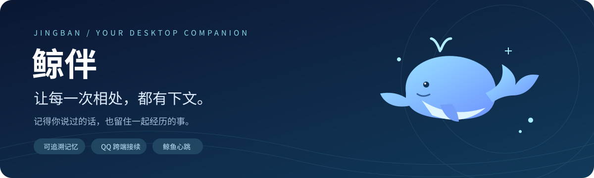
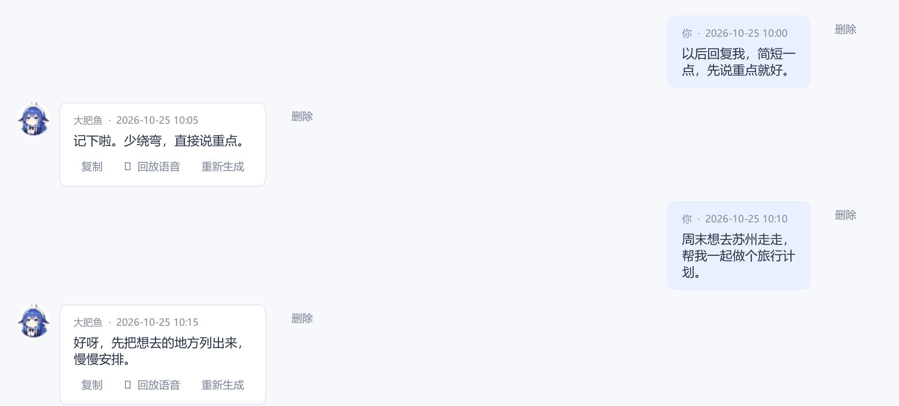
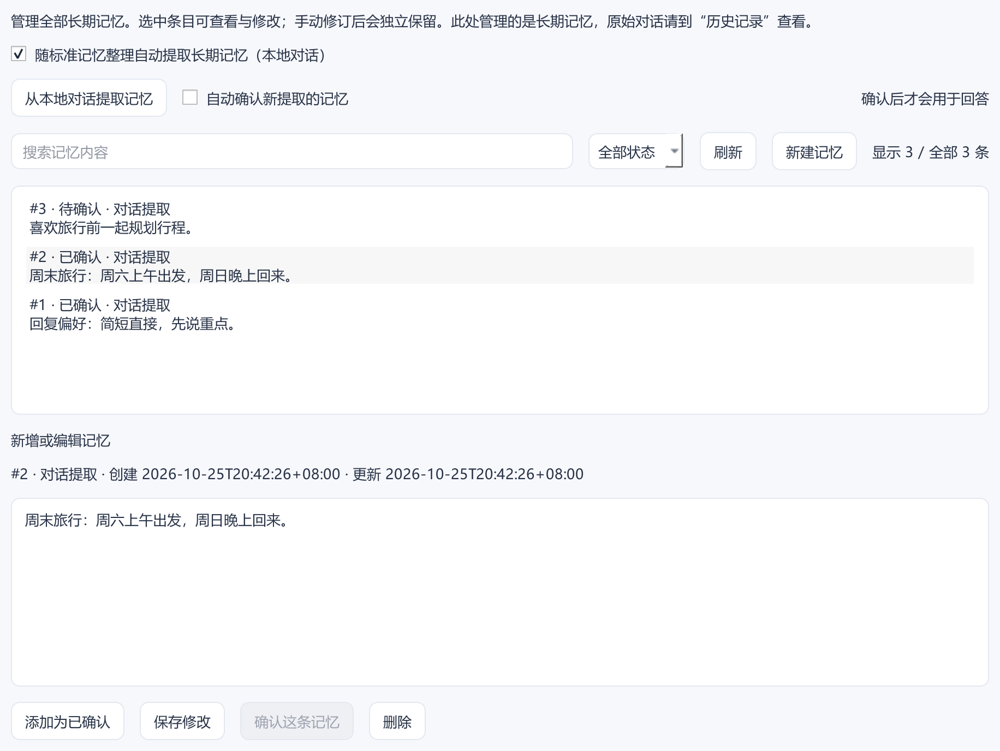

<div align="center">



# 鲸伴 · JingBan

**有记忆的 AI 桌面伙伴，和你把日常继续下去。**


[官网与下载](https://jingban.xueluosh.top/download.html) · [快速开始](docs/GETTING_STARTED.md) · [记忆设计](docs/MEMORY.md) · [开发与插件](docs/DEVELOPMENT.md) · [更新日志](CHANGELOG.md)

</div>

---

你提过的偏好、还没做完的计划、一起聊过的旧事，值得在下一次对话里被接住。

**鲸伴**是一款 Windows AI 桌面陪伴应用。她以「大肥鱼」为默认角色，把可回查的聊天、会更新的事件记忆、QQ 跨端接续和自主活动放进同一个桌面。日常可以闲聊、语音、一起看视频；需要认真做事时，也能切到工作模式。

## 一眼认识鲸伴

| 能力 | 相处时会发生什么 |
| --- | --- |
| **记得你，也能查到原话** | 稳定偏好单独管理，旧事按需检索，引用可回到来源消息 |
| **事情有后续，记忆有变化** | 计划、进展、完成或取消能形成事件修订，保留来源与状态 |
| **桌面聊到一半，QQ 接着说** | 明确绑定本人 QQ 后跨端接续；其他联系人按身份隔离 |
| **她也有想继续做的事** | 鲸鱼心跳围绕兴趣、见闻和持续打算，选择行动、搭话或休息 |
| **闲聊与工作各有空间** | 两种模式分别保留近期对话和草稿，共享记忆与历史查询 |
| **把声音和画面带进来** | 流式语音、图片与文档、视频抽样分析，以及网页和图片工具 |
| **按你的习惯生长** | 原生 Python 插件、部分 DSH 插件兼容、桌宠与透明挂件 |

## 记忆，让相处有下文

鲸伴把 **原始消息、长期偏好、事件进展** 分别保存。她可以先找相关线索，再按需要读回原话；你也可以查看、审核和修改记忆。

- **偏好留得住**：已确认的长期记忆参与后续回答，手动条目独立保留。
- **旧事接得上**：事件可以更新状态、查看修订，并追溯到当时的用户消息。
- **原文找得到**：历史记录和附件关系保存在本机，引用卡可打开对应消息。
- **上下文按需取**：每轮选取相关资料，较早内容继续保留供检索，无需反复塞入全部历史。

<table>
  <tr>
    <td width="50%"></td>
    <td width="50%"></td>
  </tr>
  <tr>
    <td align="center">一句“以后简短一点”，也可以成为持续的偏好。</td>
    <td align="center">记住什么，由你查看、确认和修改。</td>
  </tr>
</table>

> 截图来自 v1.47 的独立演示数据库，用于展示真实客户端控件，不含个人聊天数据；当前版本的布局与选项可能有所调整。记忆整理和召回受模型与文字检索影响，不保证每次都完整命中。

[了解记忆的工作方式 →](docs/MEMORY.md)

## QQ 接续，同一段相处

在电脑上聊过的事，可以在明确绑定的本人 QQ 中继续。私聊支持文字、图片、表情和语音，并保留客户端记录。v1.75 会将同一联系人短时间连续发送的内容合并理解，闲聊收尾也可以选择不回复。

QQ 工作区整合连接登录、联系人、信任与权限、空间与资料、主动互动及运行记录。启用相应权限后，她可以主动联系、安排账号活动；实际发送与资料操作以桥接回执和平台状态为准。

**接入方式**：完整发行版提供内置 OneBot 管理；源码用户可连接已有的 OneBot 11 服务。扫码登录、本人身份绑定和权限开关都由你设置。

## 鲸鱼心跳，她也有自己的下一步

她可以保留想继续的事、收集实际见闻，选择研究、创作、浏览、看视频、聊天或休息。观看和分享分别决定；打开心跳不意味着每次都要来打断你。

「鲸鱼心跳」工作区能查看持续打算、素材与运行情况。浏览与账号活动尊重安静时段、工作模式和已保存的设置。启用后需要保持应用运行，并会产生模型用量。

电脑操作另有总开关和批准方式；可选的电脑玩闹会实际移动鼠标或挪动窗口，新安装默认关闭，并提供 Esc、停止指令和托盘停止入口。

## 声音、画面与扩展

<details>
<summary><b>语音、附件、浏览与视频</b></summary>

- 豆包在线流式语音，或可选的本地 Qwen 语音；支持暂停、继续及历史回放。
- 图片、PDF、DOCX、文本与视频附件。视频依赖 FFmpeg 抽样画面，不包含完整音轨转写；扫描 PDF 暂不支持 OCR。
- 网页搜索、公开网页阅读、搜图和简单 SVG 绘图；可接入已有登录的日常浏览器。
- 工具过程与回执可查看，区分搜索摘要、实际网页、历史资料和本轮观测。该机制不能保证消除所有模型错误。

</details>

<details>
<summary><b>原生插件、DSH 兼容与桌面挂件</b></summary>

- 原生 Python 插件提供生命周期、独立设置、窗口托管、事件订阅与草稿接口。
- DSH 兼容页支持导入、依赖准备及独立界面；兼容性取决于插件实际使用的接口。
- 部分桌宠和透明挂件可显示在主窗口或桌面，支持拖动、位置保存和隐藏恢复。
- 支持 DSH 历史导入、预览与去重，方便带着旧记录开始。

插件运行环境与主应用同样拥有本机权限，依赖及上游许可分别适用。详见 [开发与插件](docs/DEVELOPMENT.md)。

</details>

## 快速开始

**想直接用**：前往 [官网下载页](https://jingban.xueluosh.top/download.html)，按页面标注的版本安装。完整安装包、源码与联网更新分别发布。

**想从源码运行**：准备 Windows 64 位与 Python 3.12，在 PowerShell 中执行：

```powershell
git clone https://github.com/luiop4/JingBan.git
cd JingBan
py -3.12 -m venv .venv
.\.venv\Scripts\python.exe -m pip install -r requirements.txt
.\.venv\Scripts\python.exe main.py
```

首次启动后，在设置中填写自己的模型服务地址、模型名和 API Key。基础聊天无需先安装 QQ、语音模型或便携运行时。视觉、语音等能力需要相应模型或服务支持。

源码仓库包含程序、界面、角色资源和当前宣传网页；可执行文件、模型、第三方运行时和个人数据按需准备。`start.bat` 面向完整便携发行目录，源码启动请使用上述 `main.py` 入口。

[完整上手指南与常见问题 →](docs/GETTING_STARTED.md)

## 文档导航

| 文档 | 内容 |
| --- | --- |
| [快速开始](docs/GETTING_STARTED.md) | 安装、源码启动、QQ、语音、备份和常见问题 |
| [记忆设计](docs/MEMORY.md) | 三层资料、事件修订、来源追溯及检索范围 |
| [标准记忆技术说明](STANDARD_MEMORY.md) | 整理批次、数据表、索引和删除规则 |
| [开发与插件](docs/DEVELOPMENT.md) | 模块结构、Qt 界面、插件 API 与构建 |
| [可选组件](tools/README.md) | uv、FFmpeg、NapCat 和本地语音 |
| [更新日志](CHANGELOG.md) | 历次版本，按新到旧排列 |
| [详细历史参考](docs/REFERENCE.md) | 保留原 README 的完整功能说明与实施记录 |

## 数据与服务

聊天与记忆默认保存在本机 `data/`，API 与连接配置保存在 `config.json`。聊天、记忆整理、视觉和在线语音会按功能需要向你配置的服务发送内容，并产生对应服务用量。本地语音另需模型、磁盘空间和兼容硬件。

仓库排除真实配置、聊天数据库、备份、QQ / 浏览器登录状态和插件私有数据。分享问题记录时也请先脱敏。电脑操作和本地插件具有当前 Windows 用户的实际权限，请按需要启用。

## 致谢

感谢 [PySide6 / Qt](https://doc.qt.io/qtforpython-6/)、[SQLite](https://www.sqlite.org/)、[NapCat](https://github.com/NapNeko/NapCatQQ)、[FFmpeg](https://ffmpeg.org/)、[yt-dlp](https://github.com/yt-dlp/yt-dlp)、[uv](https://github.com/astral-sh/uv) 及相关模型服务与社区项目。

DSH 社区的插件与主动行为设计也为兼容和实现提供了参考，具体来源保留在 [详细参考](docs/REFERENCE.md) 中。第三方代码、资源和模型分别遵循各自的许可；本仓库暂未附项目整体的开源许可证。

---

<div align="center">
  
  <p><b>记得你说过的话，也期待下一次见面。</b></p>
  <sub>鲸伴 · 有记忆的陪伴</sub>
</div>
