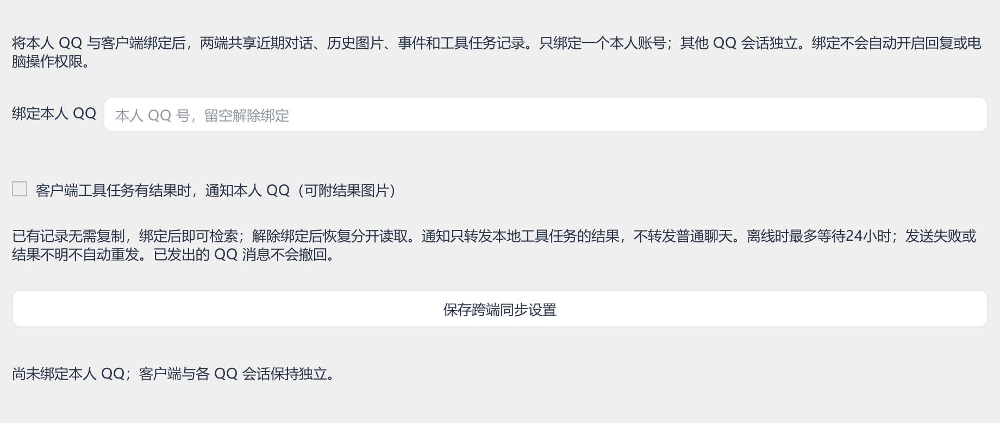

# 开始和鲸伴相处

[← 返回项目首页](../README.md)

鲸伴面向 **Windows 64 位桌面**。聊天需要你自己的模型服务配置；QQ、语音、视频和电脑操作可以按需开启。

## 选择使用方式

| 你想做什么 | 推荐入口 |
| --- | --- |
| 安装后直接使用 | [官网下载页](https://jingban.xueluosh.top/download.html) |
| 阅读代码、修改界面、开发插件 | 下方的源码启动流程 |
| 了解记忆如何保存与召回 | [记忆设计](MEMORY.md) |

源码版本由根目录 `version.json` 标识。完整安装包与源码、联网更新分别发布，下载页会标注安装包自己的版本；不要用源码版本推断下载包版本。

## 从源码启动

### 1. 获取代码

```powershell
git clone https://github.com/luiop4/JingBan.git
cd JingBan
```

### 2. 准备 Python 与依赖

推荐使用 **Python 3.12（64 位）**。以下命令在项目根目录的 PowerShell 中运行：

```powershell
py -3.12 -m venv .venv
.\.venv\Scripts\python.exe -m pip install -r requirements.txt
```

`requirements.txt` 是应用依赖入口；`requirements-app.lock.txt` 保存开发机器的依赖快照，供发行环境复现参考。可选本地语音使用单独的环境和依赖。

### 3. 直接打开应用

```powershell
.\.venv\Scripts\python.exe main.py
```

第一次运行自动创建 `config.json` 和本地数据目录。在应用设置里填写 API Key、模型名和服务地址；也可参考 `config.example.json`。示例中的角色设定是虚构人设，实际能力以模型服务和已开启功能为准。

这里使用 `main.py` 直接启动。`start.bat`、`launcher.py` 和便携版启动器面向带 `.app-venv`、`runtime/python` 的发行目录，不能直接替代上述 `.venv` 启动流程。

### 4. 发出第一条消息

先确认普通文字聊天正常，再尝试附件、记忆和其他能力。支持视觉输入的模型才能分析图片和抽样视频画面；接口兼容性、模型名及费用以服务商实际提供的服务为准。

## 配好记忆

1. 打开「长期记忆」，添加或审核你希望她记住的偏好；已确认条目才参与回答。
2. 打开「记忆方案」，查看标准记忆开关、历史整理进度和事件来源。
3. 若想整理以前的记录，点击「整理历史 / 继续」。这会调用已配置的模型，并计入 API 用量。

自动整理在满足累计消息数量并空闲后处理，不是每发一句就立即产生记忆。摘要可能遗漏或理解有误，具体规则见 [记忆设计](MEMORY.md)。

## QQ 接入

完整发行版可在「QQ 接入」启动内置 OneBot；源码仓库不包含 NapCat 二进制运行组件，可先连接你自己安装并登录的兼容 **OneBot 11 WebSocket** 服务。

填写桥接地址、访问令牌和信任名单，保存后连接。自动回复、主动互动与电脑操作分别设置，先从少量信任联系人开始。本人的 QQ 必须明确绑定，绑定后的跨端接续规则才会生效；其他联系人的记录按身份隔离。



*v1.47 的真实控件演示，未绑定个人账号；当前版本的入口和布局可能调整。*

扫码、账号验证和平台风控由用户自行完成。更多说明见 [OneBot 组件说明](../onebot/README.md)。

## 语音、视频与浏览

| 能力 | 准备事项 |
| --- | --- |
| 豆包流式语音 | 在语音页填写已开通服务的密钥、资源 ID 和音色 ID，保存后试听 |
| 本地 Qwen 语音 | 通过应用安装入口准备独立环境、模型和参考音频；需要额外磁盘与兼容硬件 |
| 视频抽样分析 | 在系统 PATH 提供 FFmpeg / ffprobe，或放到 `tools/ffmpeg/bin/`；模型需支持视觉 |
| 日常浏览器连接 | 在「鲸鱼心跳 → 浏览与活动」按界面提示接入已有登录的浏览器 |

源码仓库不携带语音模型、运行时或登录资料。辅助组件来源与目录见 [tools/README.md](../tools/README.md)。视频采用画面抽样，不包含完整音轨转写；扫描 PDF 暂无 OCR。

## 鲸鱼心跳与电脑操作

打开鲸鱼心跳后，她可以围绕近期聊天、兴趣、实际见闻和持续打算，决定做事、聊天或休息。应用需要保持运行，活动会产生模型用量。安静时段、工作模式及已保存的开关会影响行为。

电脑操作在聊天栏单独启用，可选择逐次确认或自动批准。电脑玩闹是额外选项，新安装默认关闭；启用后可能实际移动鼠标或挪动窗口，按 **Esc**、使用停止指令或托盘入口可停止。关闭权限不会撤销已经发生的文件或应用操作。

## 备份与迁移

在「设置 → 会话与记忆 · 导出 / 导入备份」操作。迁移包包含聊天与附件等私人内容，需要妥善保存；它不包含模型 API 密钥、虚拟环境和语音模型。导入会替换本机数据，应用会先保存恢复备份，完成后需重新启动。

如果从 DSH 迁移，请使用历史导入入口，先预览范围再导入；程序支持去重。具体格式和历史版本差异可查阅 [详细参考](REFERENCE.md)。

## 遇到问题

- **源码无法启动**：确认使用的是 Python 3.12 64 位，并用同一个 `.venv` 安装依赖及运行 `main.py`。
- **缺少 `tools/uv.exe`**：这是发行环境安装脚本所需组件，源码基础聊天可使用上面的标准 Python 流程。
- **看不了图片或视频**：检查模型视觉能力、FFmpeg 路径与平台访问情况。
- **QQ 没有回复**：检查桥接在线状态、令牌、信任名单及自动回复开关，并查看界面运行记录。
- **心跳没有马上说话**：她可能选择休息或继续后台活动，主动性不等于每次唤醒都发消息。

反馈时附上软件版本、重现步骤和脱敏错误信息即可。请不要上传真实的 `config.json`、聊天数据库或登录日志。
