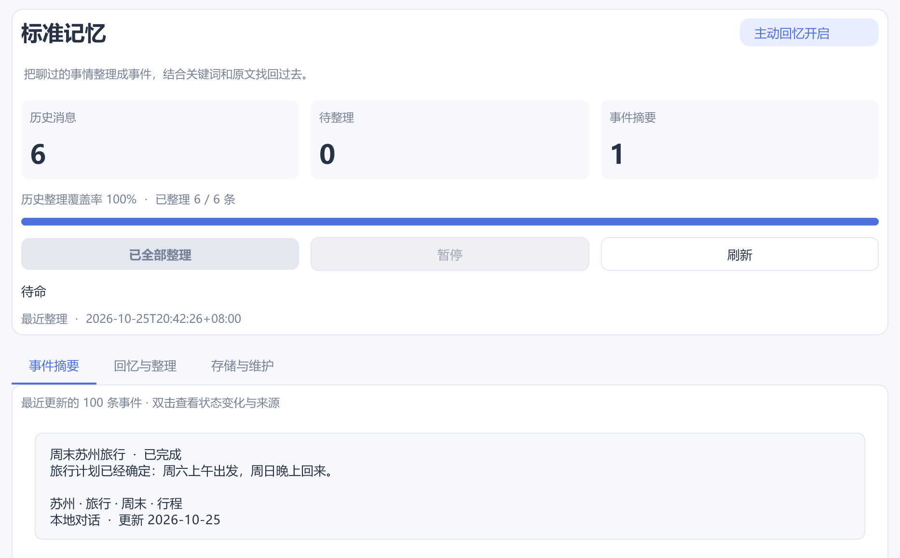

# 记忆：能接续，也能回查

[← 返回项目首页](../README.md) · [完整技术说明](../STANDARD_MEMORY.md)

鲸伴把聊天原文、稳定偏好和事件进展分别保存，在需要时取回相关内容。聊天记录保存在本机 SQLite 中，重启后仍可检索；发送给模型的上下文按当前话题组装。

## 三种资料，各有用途

| 层次 | 保存什么 | 如何使用 |
| --- | --- | --- |
| 原始消息 | 对话正文、时间、附件关系和消息编号 | 搜索原话、回读附件、展示可点击的引用 |
| 长期记忆 | 稳定偏好、个人信息及手动条目 | 审核后参与回答，按相关性选择，较早条目可再检索 |
| 事件记忆 | 发生的事、状态、关键词和来源 | 自动召回相关事件，查看修订及对应原消息 |

原文不会因为生成了摘要而被替换。手动维护的长期记忆也不会被自动提取覆盖。

*v1.47 独立演示数据截图，展示真实客户端控件；当前版本布局可能调整。*

## 一件事，可以继续变化

> 示例场景：先说“周末想去苏州”，后来改成“这周先不去了”。

整理器可以把新进展关联到同一事件，将状态从「计划中」更新为「已取消」，保留来源和修订记录。已实现的状态包括：未明确、计划中、进行中、已完成和已取消。

匹配由模型与程序规则共同处理，不保证每次都识别为同一件事；不确定时可以保留为独立事件。程序按来源顺序与事件版本检查，避免补整理旧消息时覆盖新进展。

## 一次回答怎样找回旧事

标准事件检索使用 SQLite FTS5 的中文双字片段和英文词；扩展不可用时降级为文字匹配。模型也能换词查询事件、历史与长期记忆，必要时读取原消息及支持的历史图片。它不是向量语义库，也不能仅凭图片相似度搜索全部旧图。

长期记忆每轮最多选择 12 条、总计不超过 2000 字符，较早条目仍保存在数据库中，可通过工具按主题查询。这样可避免把全部历史重复塞进每一轮请求，但检索和记忆整理本身仍会产生模型用量。

## 记忆整理什么时候发生

自动整理开启后，新增未整理消息累计达到 12 条，在一次正常回复结束且空闲约 10 秒后处理一批。旧消息需要手动点击「整理历史 / 继续」。自动整理失败后，本次运行不会不断重试，可查看错误后手动继续。

每批最多 12 条消息，事件摘要必须关联到该批的用户原消息。长消息只取前 1600 字做摘要，附件内容不进入事件整理；原附件仍可通过历史工具读取。自动提取本地长期偏好可以和事件整理共用一次请求，QQ 对话不会进入全局个人长期记忆。

## 跨端与双模式

普通模式与工作模式分别保留近期聊天和草稿，共享长期记忆、事件记忆及历史查询能力。QQ 本人身份需主动绑定，其他联系人按身份隔离；具体同步范围以当前模式和绑定状态为准。

## 查看、修正、删除

「记忆方案」展示整理覆盖率、事件和来源，双击事件可查看修订；「长期记忆」可审核、编辑或删除条目。「历史记录」用于搜索原文与附件。

“清理显示”只是隐藏消息，仍可回查。永久删除事件的任一来源消息，会删除相关整条事件和索引；剩余来源可在后续整理中重新形成摘要。独立长期记忆按自己的管理规则维护，不会因为删除来源消息而自动保证全部清除。

数据保存在 `data/chat_history.sqlite3`。本地保存不代表完全离线：聊天、记忆整理、图片分析会向你配置的服务发送完成请求所需的内容。
